# Cybrdek layout audit — #101, step 1

Captured **2026-11-27**, from merged main **[`6fac70e`](https://github.com/Natkiio/cybrdek/commit/6fac70e8c5918c1cfb64cb33235200bd7e82fbad)**, immediately after #122. This is a review baseline, not a redesign or a change to product code.

**Coverage:** all 20 requested page/role/section states at **390 × 900** and **1280 × 900**, plus player Campaigns and signed-out Account: **44 captures, each with a viewport and a full-page PNG (88 images)**. The table under each page shows the initial viewport; click it for the complete page. [Capture measurements](manifest.json).

**Fixtures:** fictional Vex/Moss characters, a populated campaign fight, a three-floor GM Architecture (two revealed to players), four lore entries and three campaigns. Auth/session, RPC, table and Realtime responses follow the existing e2e fake patterns. All Supabase requests were intercepted; no live database writes or migration. Maps/fonts are local app assets. Rules shows the initial local-PDF loader; no private rulebook PDF was loaded or published. New character shows the initial HANDLE step; closed edit/confirmation forms are not an exhaustive UI-state audit.

**How to read this:** the three or four bullets per page are reviewer observations and design candidates for Nathan to confirm, not claims that Nathan already dislikes them. **Measured** means DOM geometry; **Observed/Visual** means visible in the capture; **Opportunity** is a proposed direction rather than a demonstrated defect. Pages with little wrong still get three prioritized discussion points. No character-sheet section reorganization is proposed: #122’s section layout is accepted; sheet notes concern controls/content within the existing sections.

**Capture caveat:** fixed bars appear at the original viewport edge inside full-page screenshots. That compositing effect does not establish that the lower content is unreachable; use the viewport preview and normal scrolling to assess occlusion.

## Biggest cross-page candidates

1. **Phone map:** substantial initial letterboxing and a multi-row toolbar put usable map detail behind controls/empty space.
2. **GM combat:** current-Turn actions, setup, NET controls and program state are spread through a 3,070px phone page and a 2,672px laptop page.
3. **Tap targets:** 36px sheet chips/lore filters and 14–22px important reference/dashboard links miss #101’s 44px aim. Small inline legal links are not the priority.
4. **Visual hierarchy:** routine help, destructive management and play actions often have similar weight. Group by the current task before changing colors or aesthetic.
5. **Long reference/editor pages:** NET Architectures, deck controls and NET rules need better internal scanning/navigation; preserve the terminal fonts and black/red/white palette.

**Checks:** all 44 captured states had `scrollWidth == viewport width` and no uncaught page errors. This does not establish all possible content lengths, keyboard flows or data states are correct. The production build succeeded. The capture script is throwaway and is not committed. Campaigns findings are handed to Claude for #103; `src/routes/campaigns` is untouched.

## Page index

- [Home](#home)
- [Characters list](#characters)
- [Sheet — COMBAT](#sheet-combat)
- [Sheet — SKILLS](#sheet-skills)
- [Sheet — NET](#sheet-net)
- [Sheet — KIT](#sheet-kit)
- [Sheet — FILE](#sheet-file)
- [New character](#new-character)
- [Dice](#dice)
- [Combat — GM](#combat-gm)
- [Combat — player](#combat-player)
- [NET Architectures — GM](#net-gm)
- [NET Architectures — player](#net-player)
- [Map](#map)
- [Lore database](#lore)
- [Rules / local PDF loader](#rules)
- [NET rules quick reference](#rules-net)
- [Campaigns — GM](#campaigns)
- [Campaigns / party dashboard](#campaigns-party)
- [Account — signed in](#account)
- [Campaigns — player (supplement)](#campaigns-player)
- [Account — signed out (supplement)](#account-sign-in)

## Home

`/` · Page height: phone **900px**, laptop **900px**.

- **Visual · both:** The resume card identifies one runner, but there is no visible way to switch runners here. A compact “other characters” link beside the card would make the next action clearer.
- **Visual · phone:** The roll-log mode buttons and GM visibility checkbox occupy a substantial block between the resume card and NEXT UP. Give the latest result priority and make the log settings secondary.
- **Opportunity · laptop:** The four NEXT UP destinations are small, equal-weight tiles. Give the current table task a stronger primary action instead of making combat, map, dice and lore visually equivalent.

| Phone · 390px | Laptop · 1280px |
| --- | --- |
| [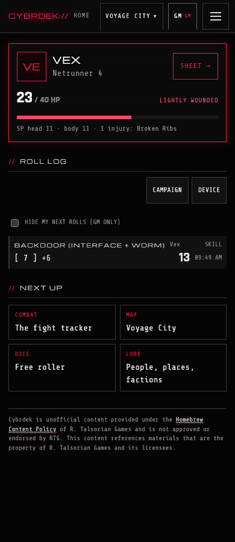](screenshots/home-390.png) | [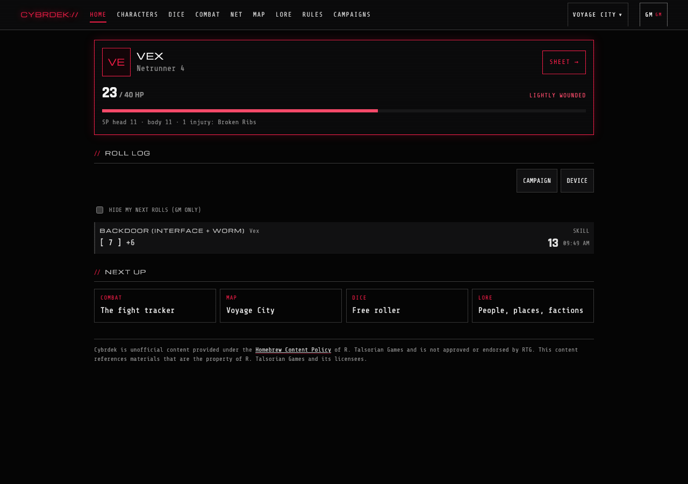](screenshots/home-1280.png) |
| [Full phone capture](screenshots/home-390.png) | [Full laptop capture](screenshots/home-1280.png) |

## Characters list

`/characters` · Page height: phone **900px**, laptop **900px**.

- **Visual · phone:** OPEN, EXPORT, RENAME and DELETE sit in one busy row; OPEN and DELETE both use red. Separate the primary action from management/destructive actions.
- **Opportunity · both:** Each card shows name and Role but no campaign, HP or last-used hint. A short summary would help distinguish characters before opening them.
- **Opportunity · laptop:** The roster remains a stack of wide, mostly empty rows. Test denser cards or a compact list with a clearly aligned action column as the roster grows.

| Phone · 390px | Laptop · 1280px |
| --- | --- |
| [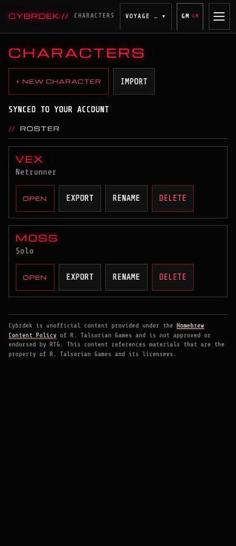](screenshots/characters-390.png) | [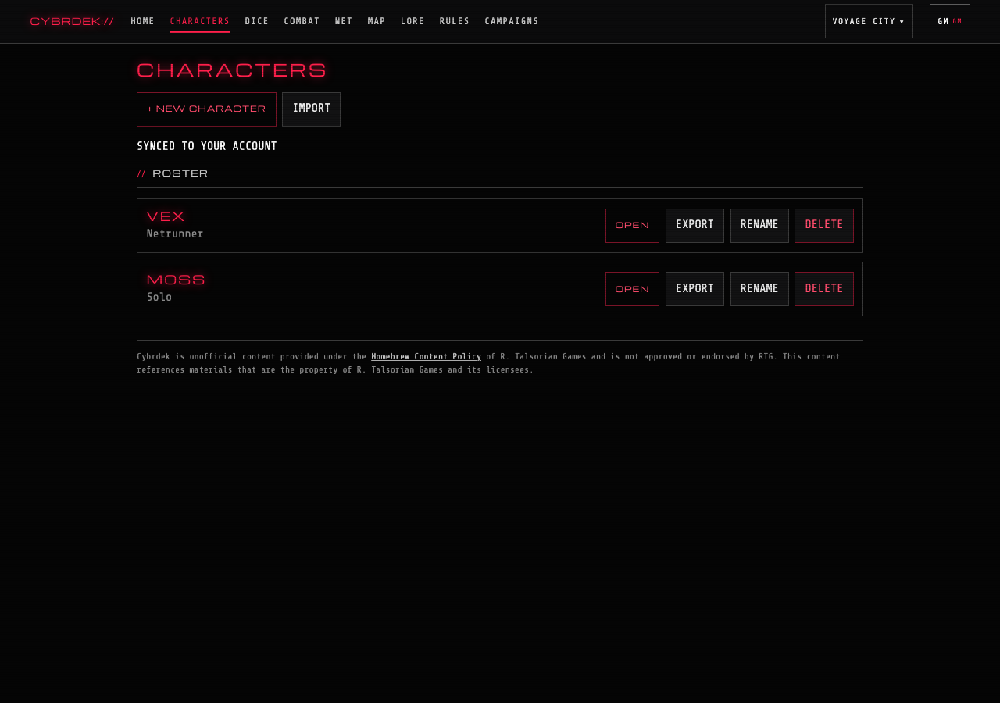](screenshots/characters-1280.png) |
| [Full phone capture](screenshots/characters-390.png) | [Full laptop capture](screenshots/characters-1280.png) |

## Sheet — COMBAT

`/characters/audit-runner#combat` · Page height: phone **1854px**, laptop **1648px**.

- **Measured · phone:** The shared HP/SP/HUM/INJ/NET status chips are 36px high, below #101’s 44px target. Increase their hit areas without changing the new section structure.
- **Visual · phone:** Weapon attack, damage, ammunition, reload and management actions form a dense cluster. Keep attack/damage prominent and separate EDIT/REMOVE from play actions within the weapon card.
- **Visual · both:** The injury panel leads with explanatory prose before its location selector and roll action. Let the actionable injury state lead, with the reference explanation secondary.

| Phone · 390px | Laptop · 1280px |
| --- | --- |
| [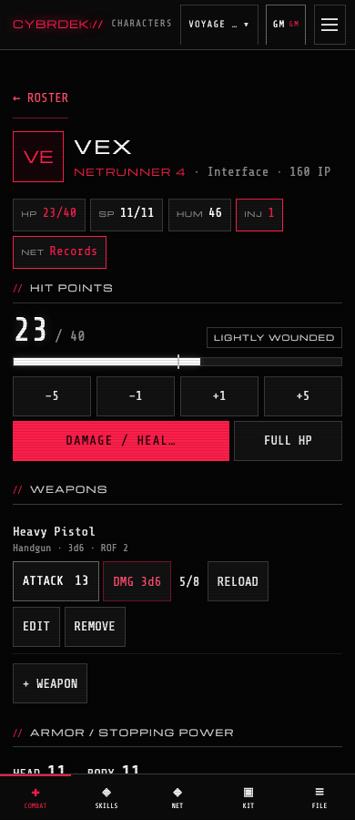](screenshots/sheet-combat-390.png) | [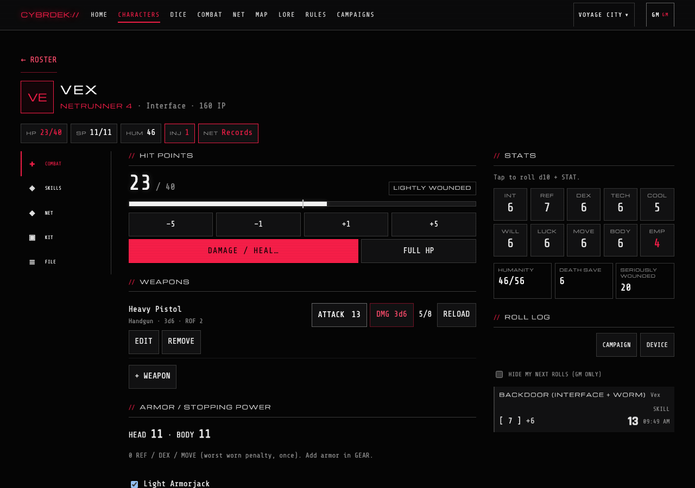](screenshots/sheet-combat-1280.png) |
| [Full phone capture](screenshots/sheet-combat-390.png) | [Full laptop capture](screenshots/sheet-combat-1280.png) |

## Sheet — SKILLS

`/characters/audit-runner#skills` · Page height: phone **1402px**, laptop **1030px**.

- **Measured · phone:** The shared status chips are 36px high. This is a hit-area issue, not a request to change #122’s sections.
- **Visual · phone:** STAT and skill rows mix large values with much smaller category/calculation labels. Improve the alignment and hierarchy of the base number versus its explanation.
- **Opportunity · both:** There is only an “all skills” toggle, with no visible search or favorites control. A way to locate one skill would help when the full list is shown; retain the current section location.

| Phone · 390px | Laptop · 1280px |
| --- | --- |
| [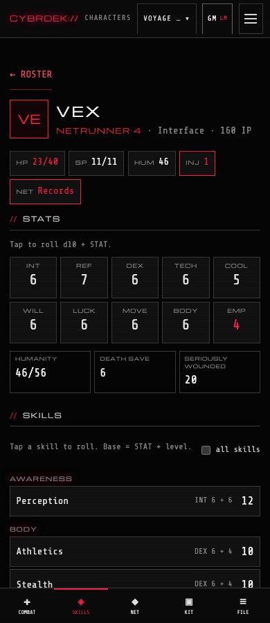](screenshots/sheet-skills-390.png) | [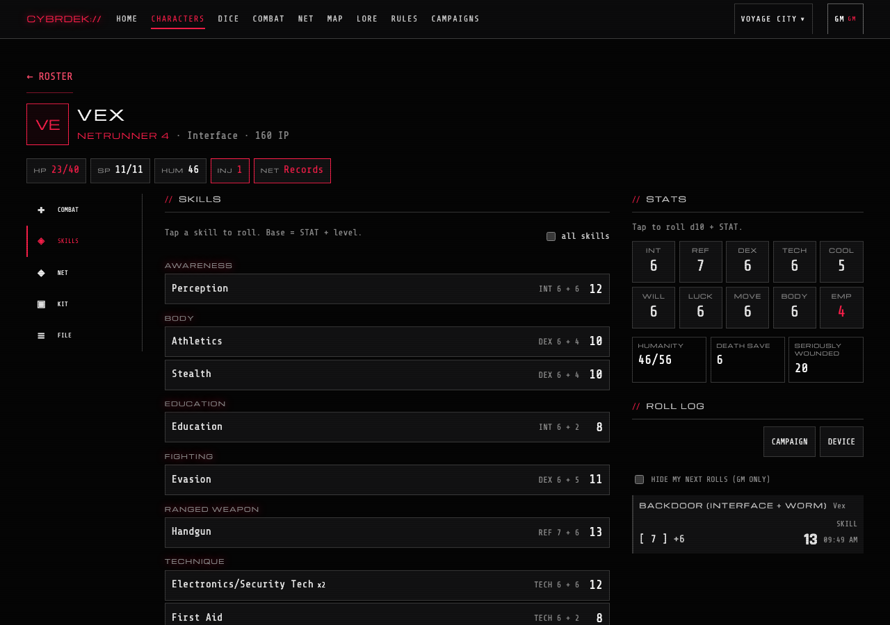](screenshots/sheet-skills-1280.png) |
| [Full phone capture](screenshots/sheet-skills-390.png) | [Full laptop capture](screenshots/sheet-skills-1280.png) |

## Sheet — NET

`/characters/audit-runner#net` · Page height: phone **2630px**, laptop **2034px**.

- **Visual · phone:** The floor card contains names, descriptions and large roll buttons in a narrow stair tile. Tighten entry text versus action grouping inside the tile; keep the accepted stairs/section design.
- **Visual · both:** Routine range reminders and unsafe-exit warnings receive a long, strongly colored text block. Distinguish the immediate danger from ongoing reference guidance.
- **Measured / visual · phone:** Status chips remain 36px high, while the NET RULES link is about 14px high. Give frequently used shortcuts a 44px hit area; the section bar itself is not the complaint.

| Phone · 390px | Laptop · 1280px |
| --- | --- |
| [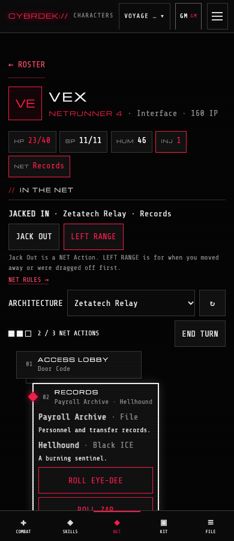](screenshots/sheet-net-390.png) | [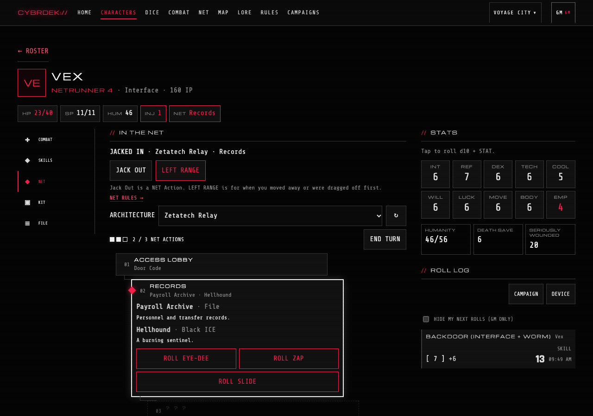](screenshots/sheet-net-1280.png) |
| [Full phone capture](screenshots/sheet-net-390.png) | [Full laptop capture](screenshots/sheet-net-1280.png) |

## Sheet — KIT

`/characters/audit-runner#kit` · Page height: phone **3336px**, laptop **2922px**.

- **Visual · phone:** The cyberdeck panel begins with several paragraphs and deck-creation controls before the loaded deck’s controls. Shorten the lead-in and distinguish “manage this deck” from “create/configure another deck.”
- **Visual · both:** LOAD/UNLOAD and REMOVE COPY appear beside the same program row with similar visual weight. Group reversible use controls separately from deleting a copy.
- **Measured · phone:** The small × controls for installed Neural Link/Interface Plugs are 36px high. Make those destructive targets easier to hit and distinguish from their descriptive text.

| Phone · 390px | Laptop · 1280px |
| --- | --- |
| [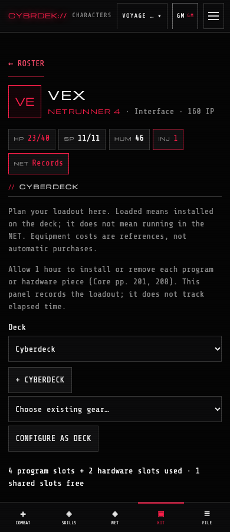](screenshots/sheet-kit-390.png) | [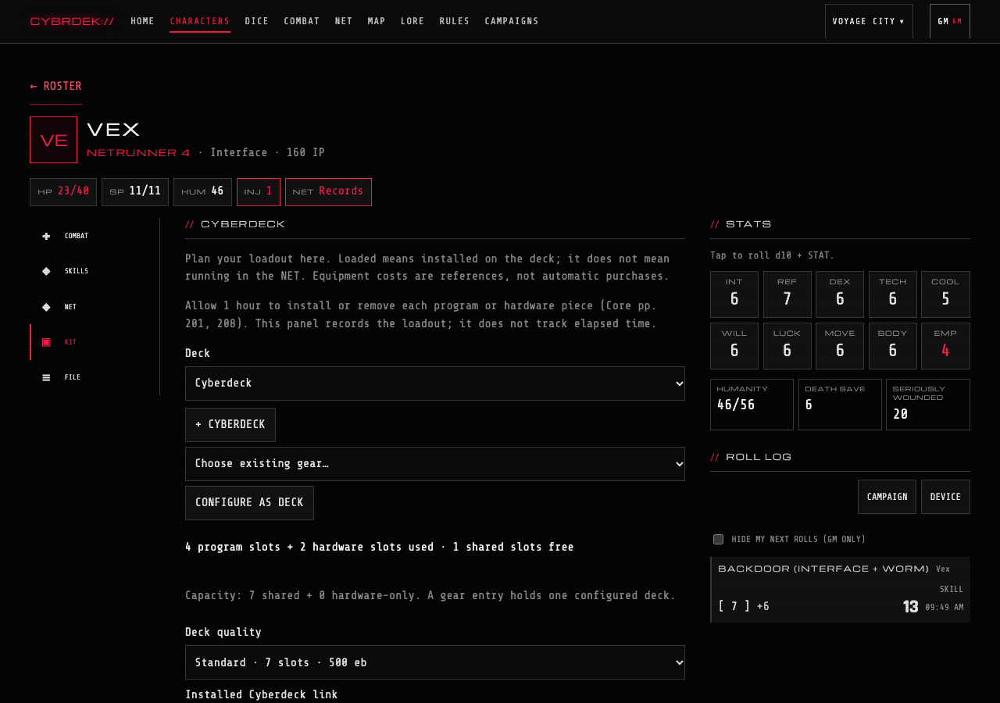](screenshots/sheet-kit-1280.png) |
| [Full phone capture](screenshots/sheet-kit-390.png) | [Full laptop capture](screenshots/sheet-kit-1280.png) |

## Sheet — FILE

`/characters/audit-runner#file` · Page height: phone **1186px**, laptop **915px**.

- **Visual · phone:** Awarding IP and spending IP use adjacent number/select fields and similar RAISE/AWARD buttons. Separate “add award” from “spend balance” more clearly within the panel.
- **Visual · both:** The unaffordable Role increase shows “RAISE · 300” next to a 160 IP balance, with its disabled state doing most of the explanation. Put the shortfall/cost beside that control.
- **Opportunity · both:** PAST VERSIONS starts with a generic explanation and a SHOW button. A last-save/time summary would make recovery more discoverable without reorganizing the sheet sections.

| Phone · 390px | Laptop · 1280px |
| --- | --- |
| [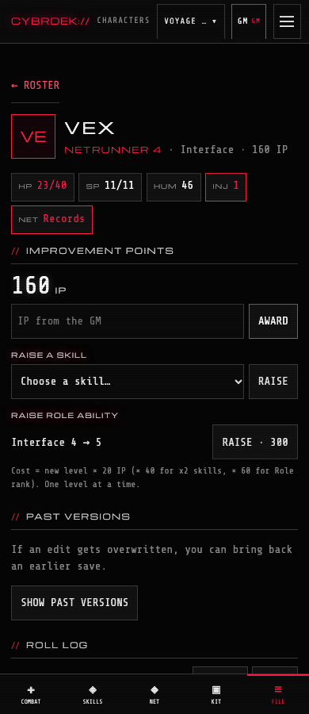](screenshots/sheet-file-390.png) | [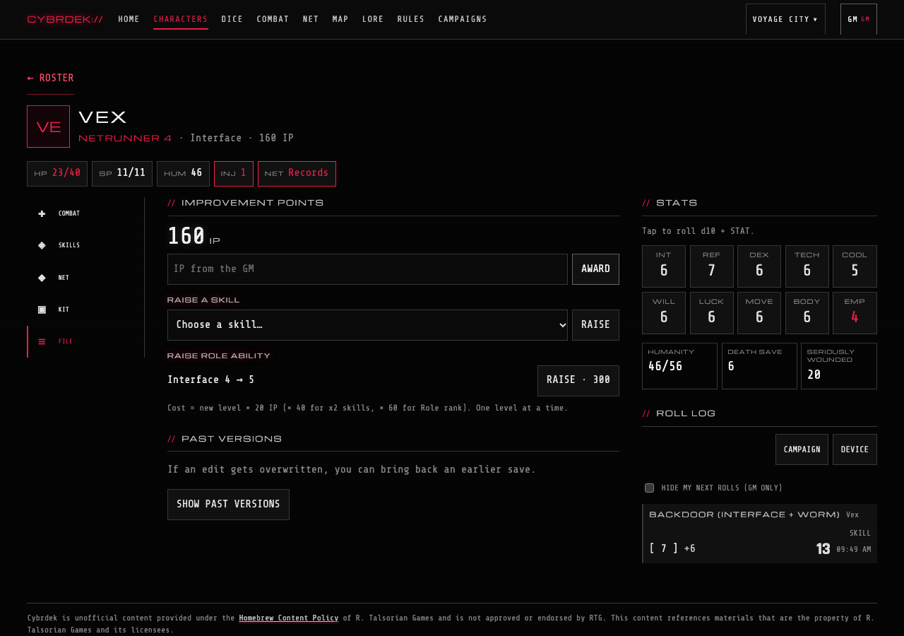](screenshots/sheet-file-1280.png) |
| [Full phone capture](screenshots/sheet-file-390.png) | [Full laptop capture](screenshots/sheet-file-1280.png) |

## New character

`/characters/new` · Page height: phone **900px**, laptop **900px**.

- **Observed · both:** “Your character needs a handle” is already shown as a red error on the untouched first step. Reserve error emphasis for an attempted progression or touched field.
- **Visual · phone:** Five abbreviated step controls share a narrow horizontal strip. Keep the current step/progress legible while making the future disabled steps less visually competitive.
- **Opportunity · laptop:** A nearly full-width text input serves a short handle, with CANCEL and NEXT far apart. A more compact form/action group would reduce scanning across the empty width.

| Phone · 390px | Laptop · 1280px |
| --- | --- |
| [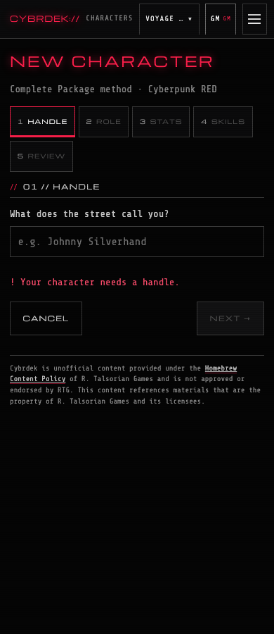](screenshots/new-character-390.png) | [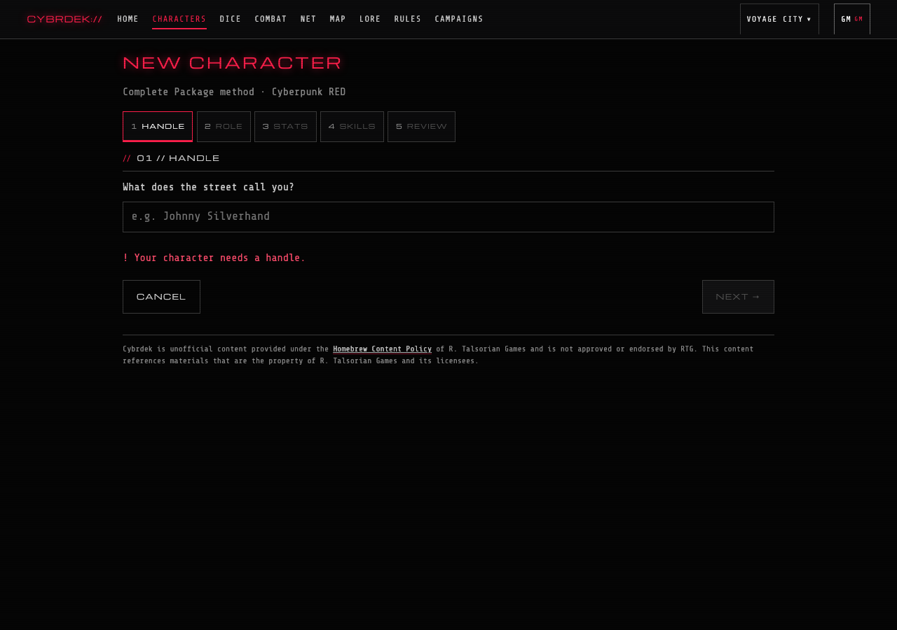](screenshots/new-character-1280.png) |
| [Full phone capture](screenshots/new-character-390.png) | [Full laptop capture](screenshots/new-character-1280.png) |

## Dice

`/dice` · Page height: phone **900px**, laptop **900px**.

- **Visual · both:** The expression field is identified mainly by its dice placeholder, while the page gives little visible guidance for modifiers. Add a persistent visible label and a compact example.
- **Visual · phone:** Seven dice presets form a tight row below the expression field. Group commonly used presets first and keep their labels easy to scan at phone size.
- **Visual · both:** The shared-log settings are visually prominent relative to the single result. Keep the latest roll close to the roller and reduce the emphasis on mode/GM settings.

| Phone · 390px | Laptop · 1280px |
| --- | --- |
| [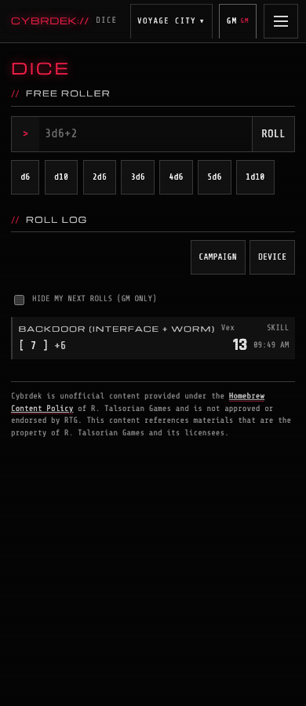](screenshots/dice-390.png) | [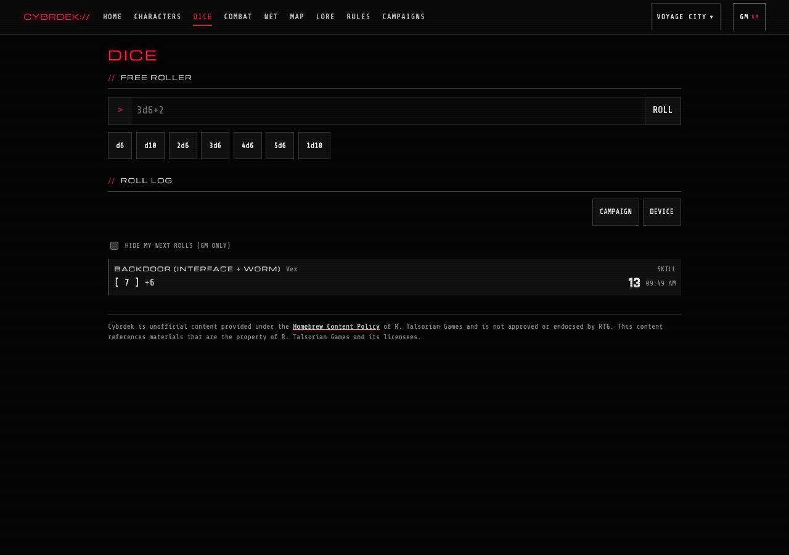](screenshots/dice-1280.png) |
| [Full phone capture](screenshots/dice-390.png) | [Full laptop capture](screenshots/dice-1280.png) |

## Combat — GM

`/combat` · Page height: phone **3070px**, laptop **2672px**.

- **Observed · phone:** The populated page is about 3,070px tall. Initiative/current actor, NET resolution and program state are separated by setup/help controls; prioritize the current Turn’s controls together.
- **Visual · both:** REMOVE NET SECURITY, MARK DEAD and routine turn controls are all exposed near the queue. Give destructive/admin actions a separate group and distinct confirmation context.
- **Visual · both:** The NET action block presents a large wall of attack, movement, exit, fire, backup and Meat Action buttons. Group actions by purpose and actor/target context instead of equal-weight buttons.
- **Opportunity · laptop:** The same long stack remains within the reading column. A queue beside the active action panel would use the laptop width more effectively.

| Phone · 390px | Laptop · 1280px |
| --- | --- |
| [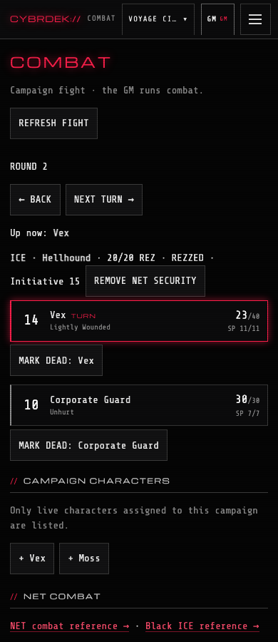](screenshots/combat-gm-390.png) | [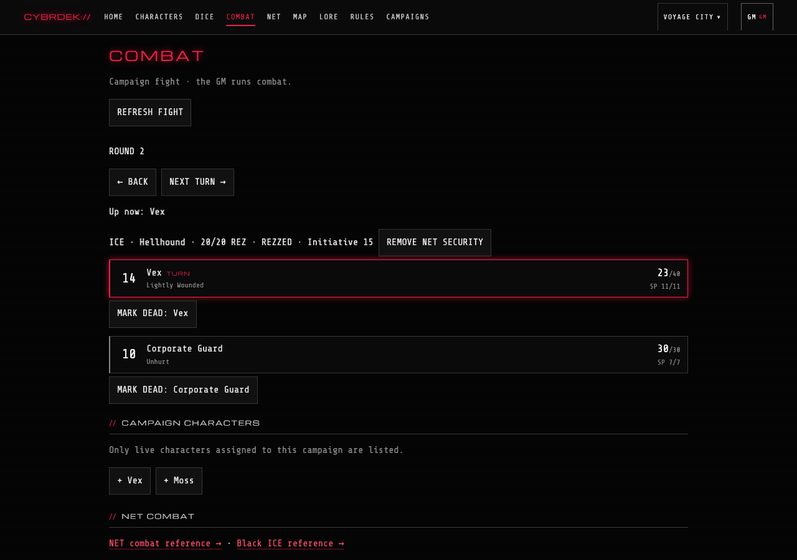](screenshots/combat-gm-1280.png) |
| [Full phone capture](screenshots/combat-gm-390.png) | [Full laptop capture](screenshots/combat-gm-1280.png) |

## Combat — player

`/combat` · Page height: phone **900px**, laptop **900px**.

- **Visual · both:** “The GM runs combat,” REFRESH and “THE FIGHT · READ ONLY” repeat the read-only context before the queue. A single concise status would free attention for the active combatant.
- **Visual · phone:** The owner’s wound, HP/SP, NET status and program state are several small lines in one card. Group the owner’s most important vitals with a stronger visual hierarchy.
- **Opportunity · both:** The current Turn is indicated mainly by border color and a small TURN tag. Strengthen its text/position cue so it remains obvious when scanning the queue without relying on red.

| Phone · 390px | Laptop · 1280px |
| --- | --- |
| [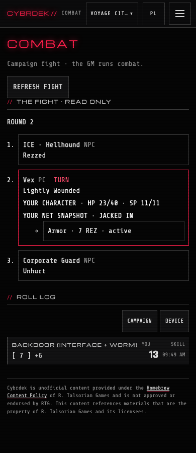](screenshots/combat-player-390.png) | [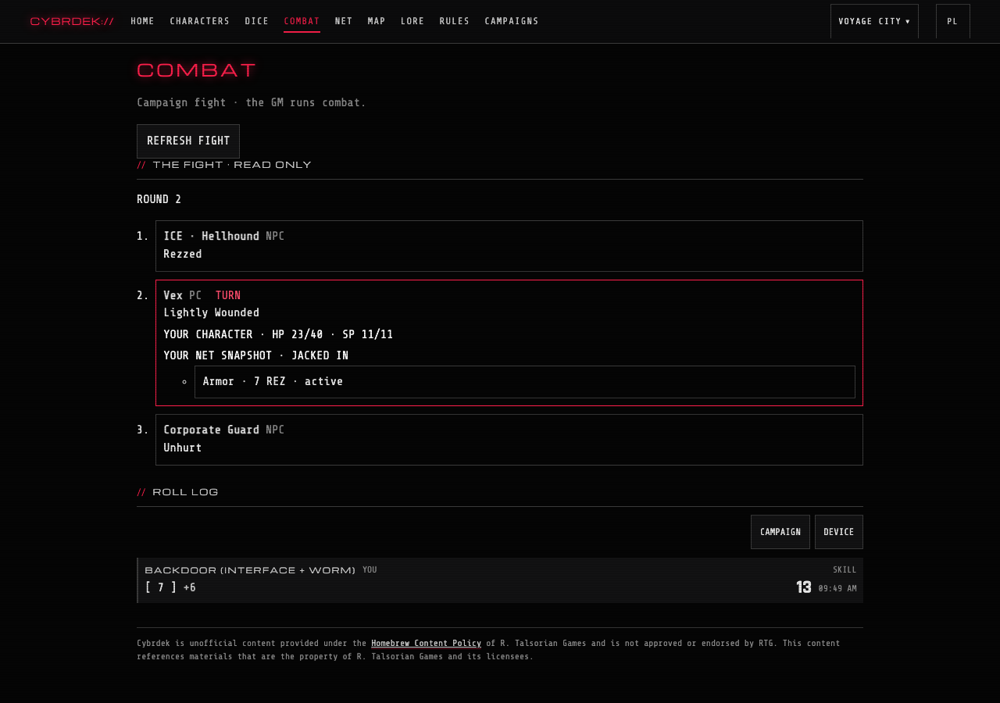](screenshots/combat-player-1280.png) |
| [Full phone capture](screenshots/combat-player-390.png) | [Full laptop capture](screenshots/combat-player-1280.png) |

## NET Architectures — GM

`/net` · Page height: phone **1699px**, laptop **1685px**.

- **Observed · both:** Blank “GM notes:” labels and generous repeated paragraph gaps lengthen each floor. Suppress empty notes and tighten related entry metadata.
- **Visual · both:** HIDDEN/REVEALED is small inline text beside notes, while REVEAL/HIDE is a separate button below. Give visibility a consistent, more conspicuous status treatment.
- **Visual · both:** EDIT ARCHITECTURE and DELETE ARCHITECTURE have similar prominence. Keep deletion away from routine reveal/edit work.
- **Opportunity · laptop:** Floors remain a long single column, even with only three sample floors. Add a compact floor index or summary beside the detailed view before adding larger Architectures.

| Phone · 390px | Laptop · 1280px |
| --- | --- |
| [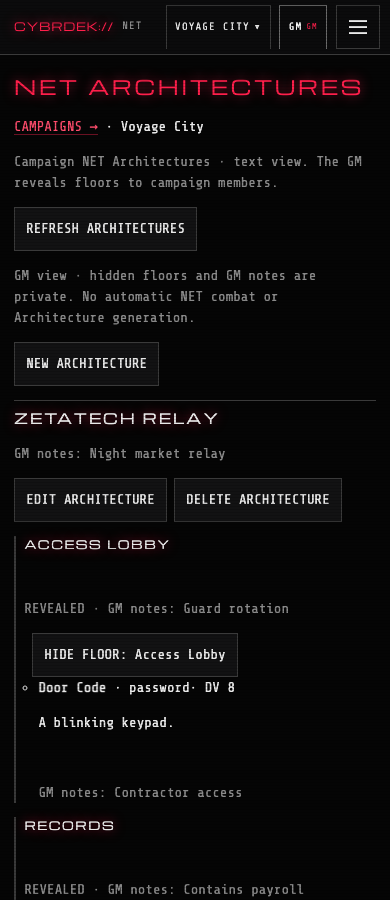](screenshots/net-gm-390.png) | [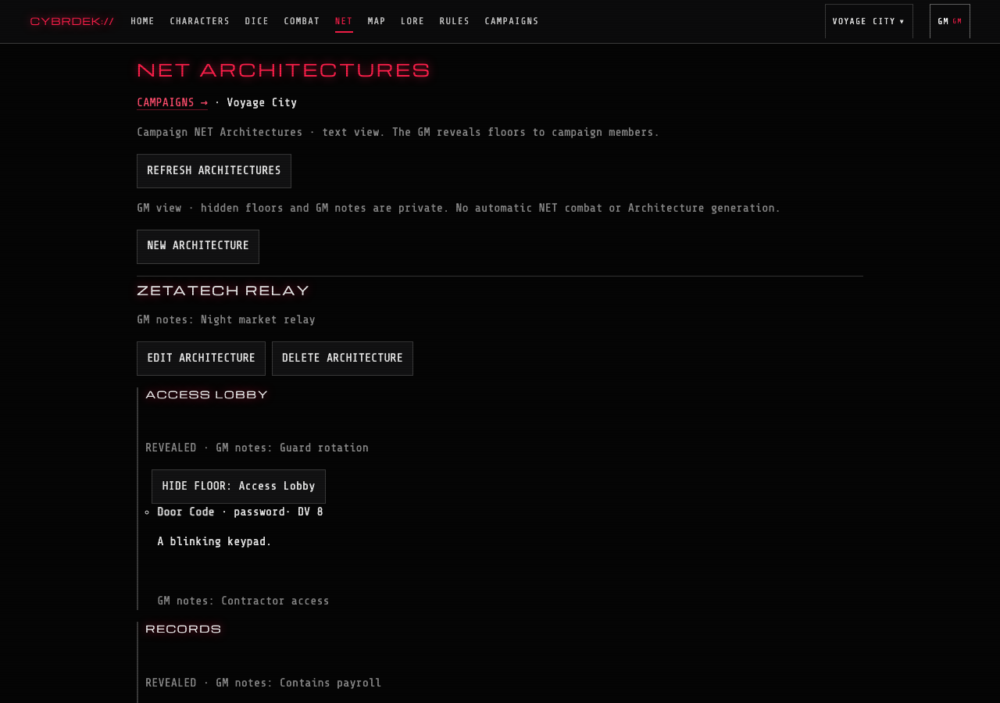](screenshots/net-gm-1280.png) |
| [Full phone capture](screenshots/net-gm-390.png) | [Full laptop capture](screenshots/net-gm-1280.png) |

## NET Architectures — player

`/net` · Page height: phone **976px**, laptop **944px**.

- **Visual · both:** Refresh plus two introductory explanations precede the Architecture name. Let the selected Architecture/revealed-floor status lead, with help text secondary.
- **Visual · phone:** Floor boundaries rely mostly on thin vertical rules and small headings. Add clearer floor grouping/numbering within this reference page, without changing the sheet stairs.
- **Visual · both:** Black ICE catalogue numbers appear as a long, muted line beneath the description. Align the stat labels/values or present them in a compact reference block.

| Phone · 390px | Laptop · 1280px |
| --- | --- |
| [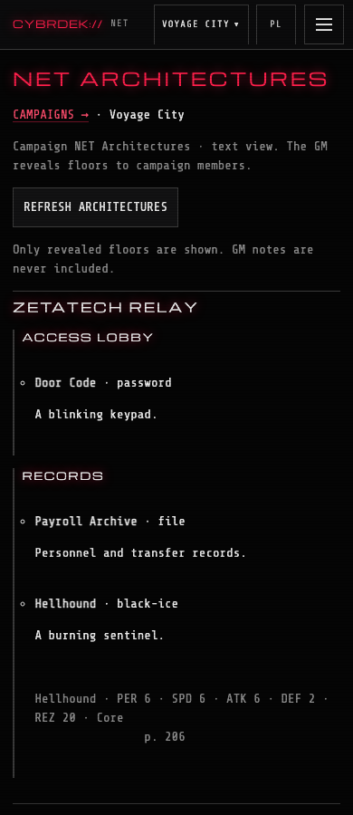](screenshots/net-player-390.png) | [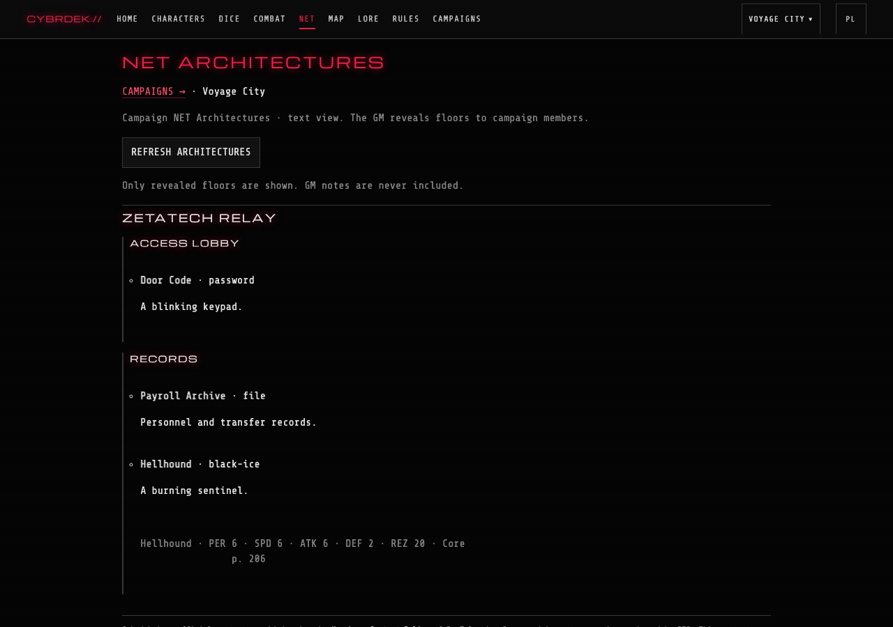](screenshots/net-player-1280.png) |
| [Full phone capture](screenshots/net-player-390.png) | [Full laptop capture](screenshots/net-player-1280.png) |

## Map

`/map` · Page height: phone **984px**, laptop **900px**.

- **Observed · phone:** The 558px map viewport contains a short fitted image with large black bands above and below it. Reduce this letterboxing or choose a more useful initial fit for the available phone shape.
- **Visual · phone:** Zoom/FIT, four pan arrows, +PIN and two instruction lines sit above the map across several rows. Consolidate the toolbar so more useful map area appears sooner.
- **Visual · both:** Dense district names overlap the city artwork at the initial scale. Use zoom-dependent labels/contrast or rely more clearly on a searchable district list for selection.
- **Opportunity · phone:** CHOOSE A DISTRICT sits below the entire map viewport. Give this non-gesture navigation route a more immediately discoverable position.

| Phone · 390px | Laptop · 1280px |
| --- | --- |
| [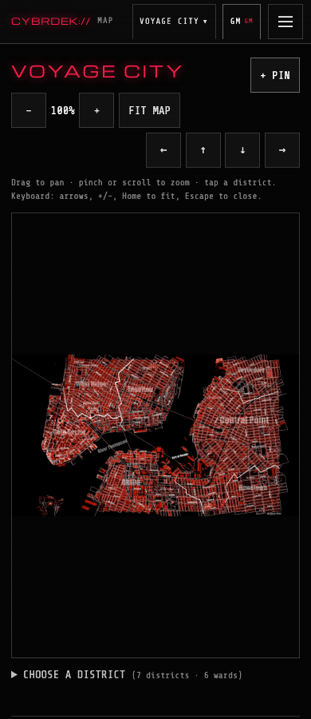](screenshots/map-390.png) | [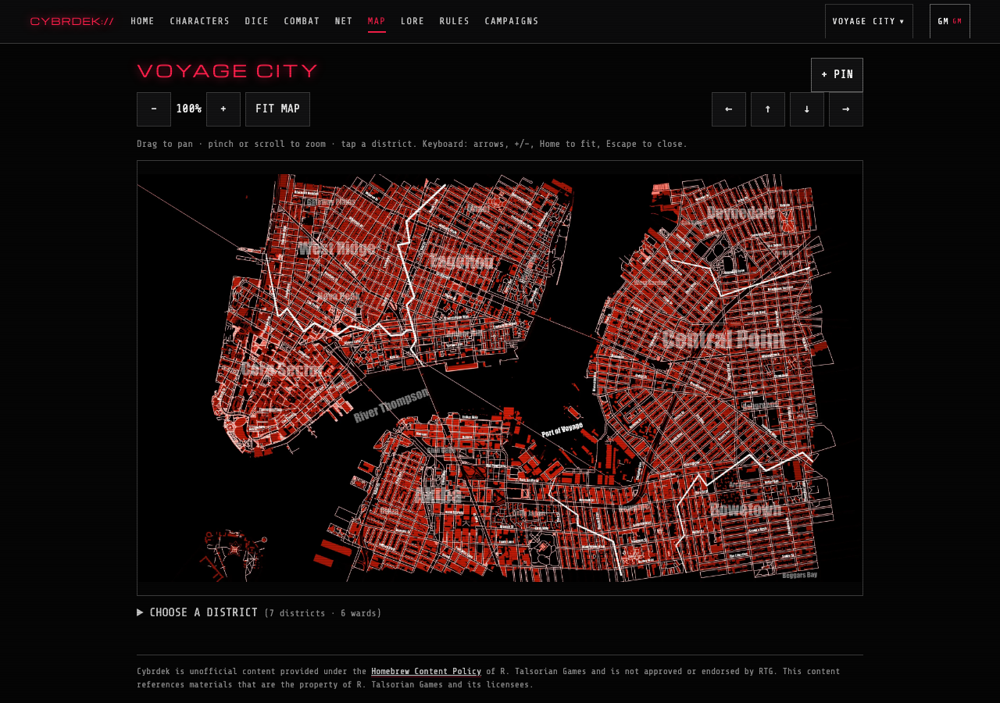](screenshots/map-1280.png) |
| [Full phone capture](screenshots/map-390.png) | [Full laptop capture](screenshots/map-1280.png) |

## Lore database

`/lore` · Page height: phone **900px**, laptop **900px**.

- **Measured · phone:** The category filter buttons are 36px high, below the 44px target.
- **Visual · phone:** Category filters wrap into two uneven rows, with the longest “Faction / Corp” label consuming much of a row. Use a more deliberate wrapping/filter layout.
- **Opportunity · laptop:** Every short entry spans the full reading column while title, type and summary remain small. Try denser cards or a clearer title/type alignment before the database grows.

| Phone · 390px | Laptop · 1280px |
| --- | --- |
| [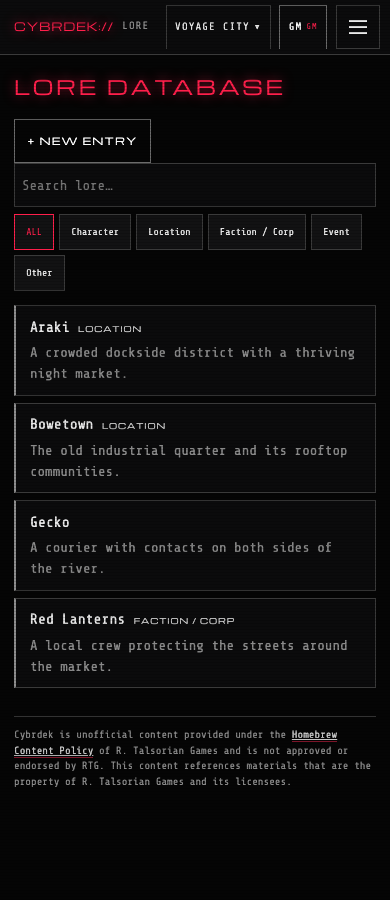](screenshots/lore-390.png) | [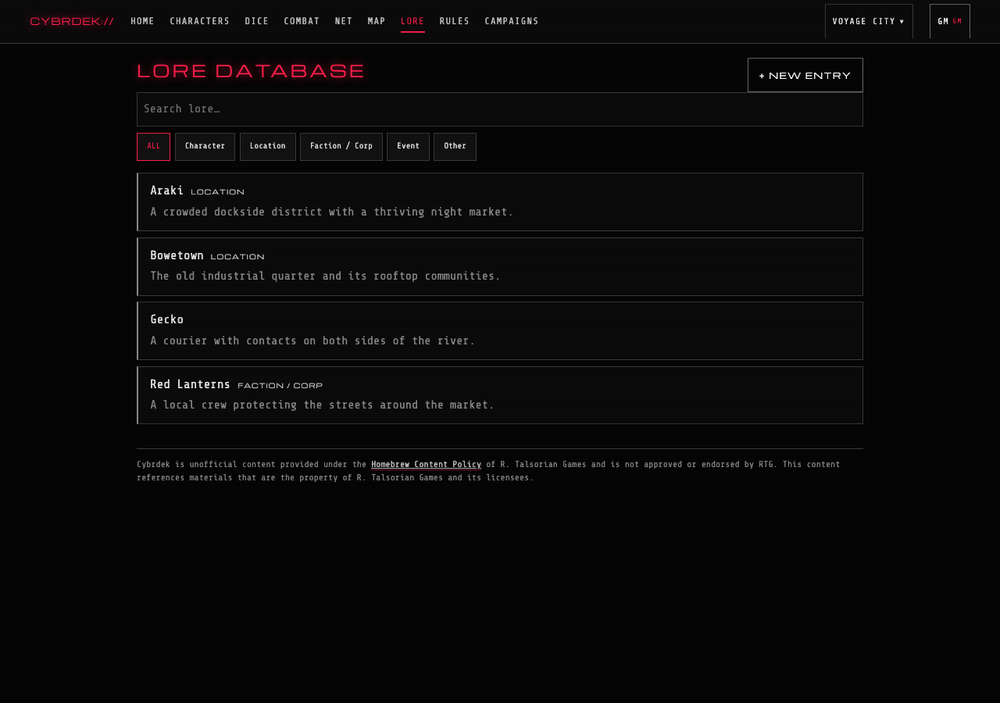](screenshots/lore-1280.png) |
| [Full phone capture](screenshots/lore-390.png) | [Full laptop capture](screenshots/lore-1280.png) |

## Rules / local PDF loader

`/rules` · Page height: phone **900px**, laptop **900px**.

- **Measured · both:** NET RULES QUICK REFERENCE is a roughly 16px-high text link, despite being the main immediately available reference action. Give it primary-action hit area and emphasis.
- **Visual · both:** The browser-native file chooser is a small control inside a very wide field. A clearer labeled load/drop area would make the first task more obvious.
- **Visual · both:** The third-party license disclosure competes with the sparse first-run content while most of the page is empty. Keep technical/legal details secondary to load, privacy and offline-use guidance.

| Phone · 390px | Laptop · 1280px |
| --- | --- |
| [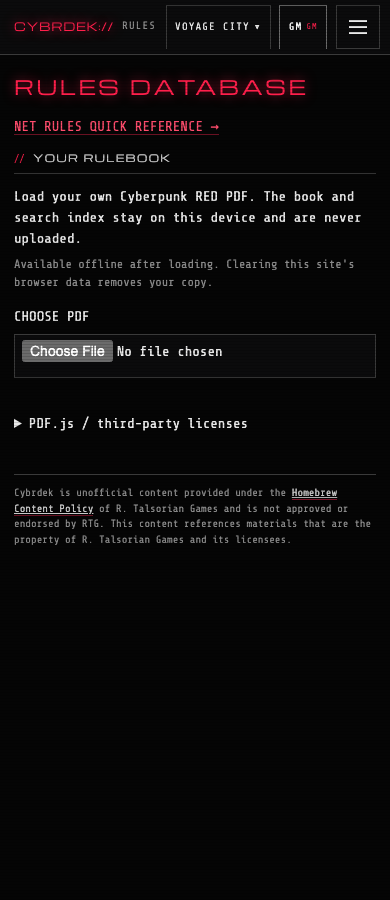](screenshots/rules-390.png) | [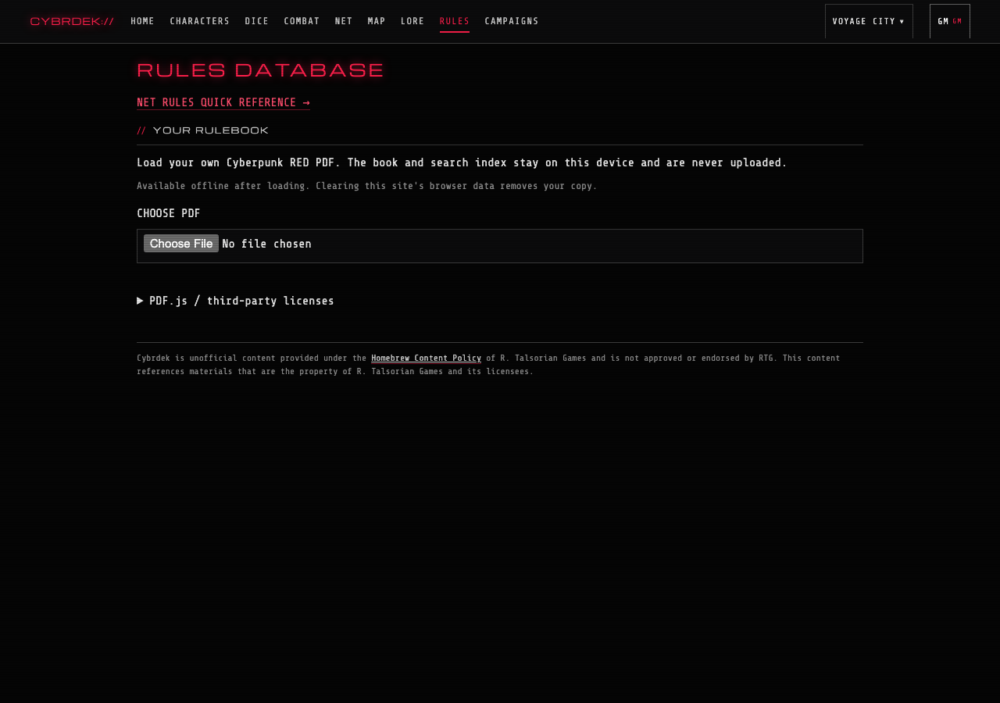](screenshots/rules-1280.png) |
| [Full phone capture](screenshots/rules-390.png) | [Full laptop capture](screenshots/rules-1280.png) |

## NET rules quick reference

`/rules/net` · Page height: phone **3313px**, laptop **2073px**.

- **Observed · phone:** The reference is about 3,313px tall, but its jump links are only at the top. Add a compact return-to-contents or persistent section navigation.
- **Visual · phone:** Several technical sections are dense lists with similar typography and long lines of exceptions. Add stronger subhead/value grouping for quick table lookup.
- **Visual · both:** Page references, explanatory text and actionable rule numbers share nearly the same visual emphasis. Make values/formulas easier to distinguish from citations and prose.

| Phone · 390px | Laptop · 1280px |
| --- | --- |
| [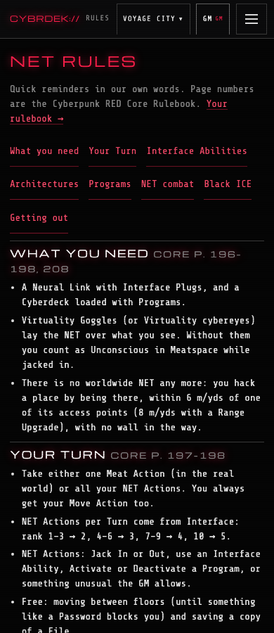](screenshots/rules-net-390.png) | [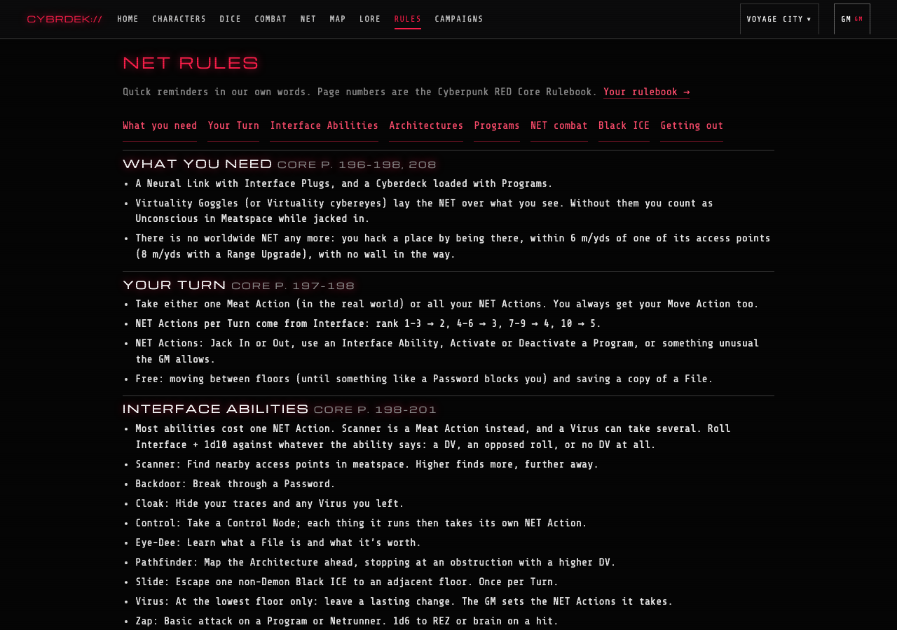](screenshots/rules-net-1280.png) |
| [Full phone capture](screenshots/rules-net-390.png) | [Full laptop capture](screenshots/rules-net-1280.png) |

## Campaigns — GM

`/campaigns` · Page height: phone **1112px**, laptop **1098px**.

- **Visual · phone:** Current-campaign identity is mainly in the site header/list marker while name, invite, party and switching controls are stacked together. Give the current campaign a clear management heading.
- **Visual · both:** Invite, party/dashboard and campaign-switching tasks have similar panel treatment. Separate active-campaign management from choosing/creating another campaign.
- **Measured / visual · phone:** OPEN LIVE DASHBOARD is a roughly 22px-high inline link beside a 44px REFRESH button. Make the primary dashboard destination as easy to tap as refresh.
- **Opportunity · laptop:** The management panels still use one long column. A campaign list beside current-campaign details could make switching and managing easier. Findings only: Claude owns #103 implementation.

| Phone · 390px | Laptop · 1280px |
| --- | --- |
| [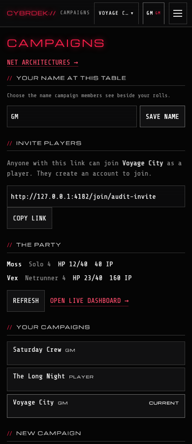](screenshots/campaigns-390.png) | [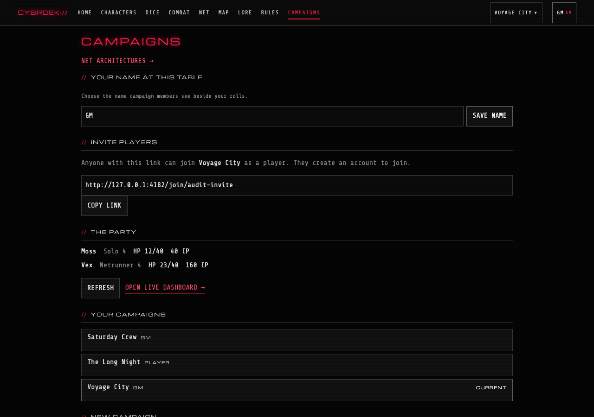](screenshots/campaigns-1280.png) |
| [Full phone capture](screenshots/campaigns-390.png) | [Full laptop capture](screenshots/campaigns-1280.png) |

## Campaigns / party dashboard

`/campaigns/party` · Page height: phone **900px**, laptop **900px**.

- **Visual · phone:** Compact cards combine HP, wound, SP, Humanity, six STATs and injury names in a few small lines. Increase hierarchy for wound/HP and deemphasize routine metadata.
- **Visual · both:** The whole character header is the expansion control, but its small chevron is easy to miss. Make “open sheet details” more explicit.
- **Opportunity · both:** Roll-log mode/visibility controls are large relative to the two-party-card summary. Keep party health/status the visual focus, with roll settings secondary.

| Phone · 390px | Laptop · 1280px |
| --- | --- |
| [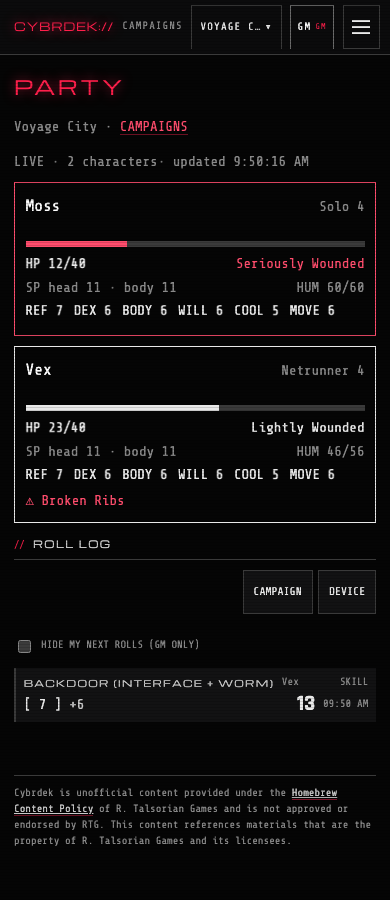](screenshots/campaigns-party-390.png) | [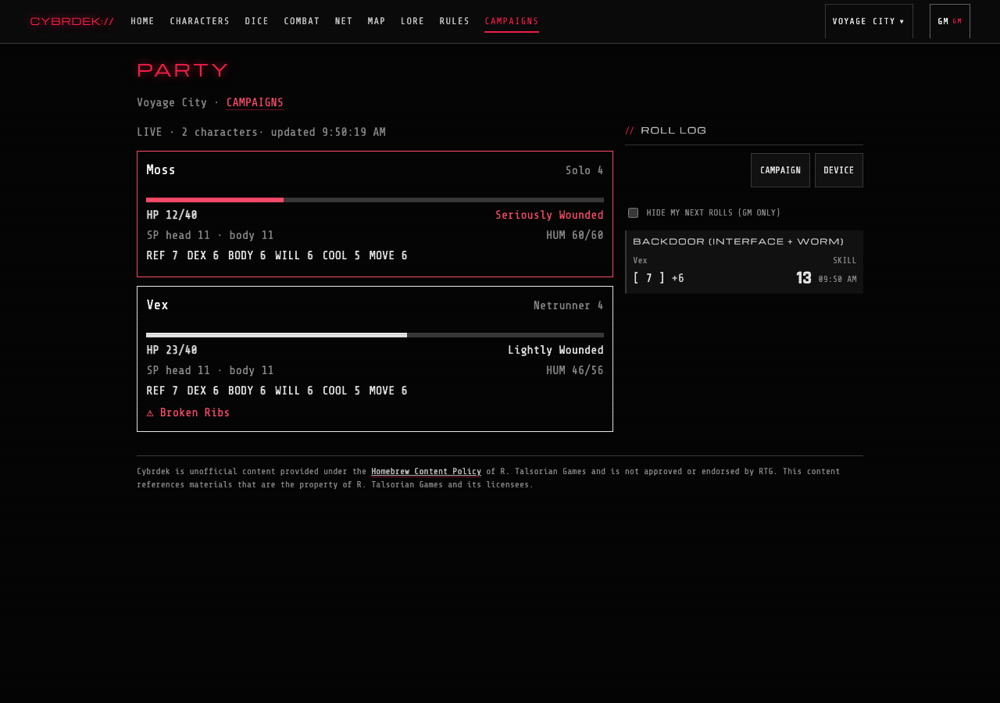](screenshots/campaigns-party-1280.png) |
| [Full phone capture](screenshots/campaigns-party-390.png) | [Full laptop capture](screenshots/campaigns-party-1280.png) |

## Account — signed in

`/account` · Page height: phone **900px**, laptop **900px**.

- **Visual · both:** SIGN OUT appears as an ordinary button within the status paragraph block. Separate this session action from the main settings task.
- **Visual · phone:** The password field and SET PASSWORD share one row; the password placeholder carries most of the visible labeling. Give the field a persistent visible label and a clearer action group.
- **Measured · both:** YOUR CAMPAIGNS is a roughly 16px-high link even though it is the main route from account status to the table. Increase its hit area and visual priority.

| Phone · 390px | Laptop · 1280px |
| --- | --- |
| [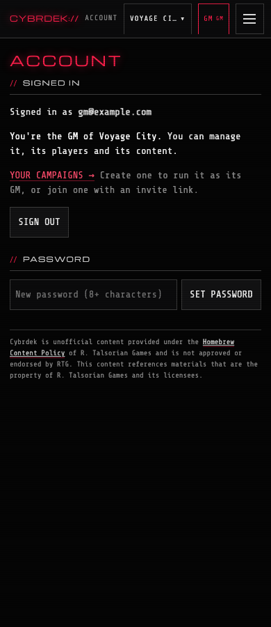](screenshots/account-390.png) | [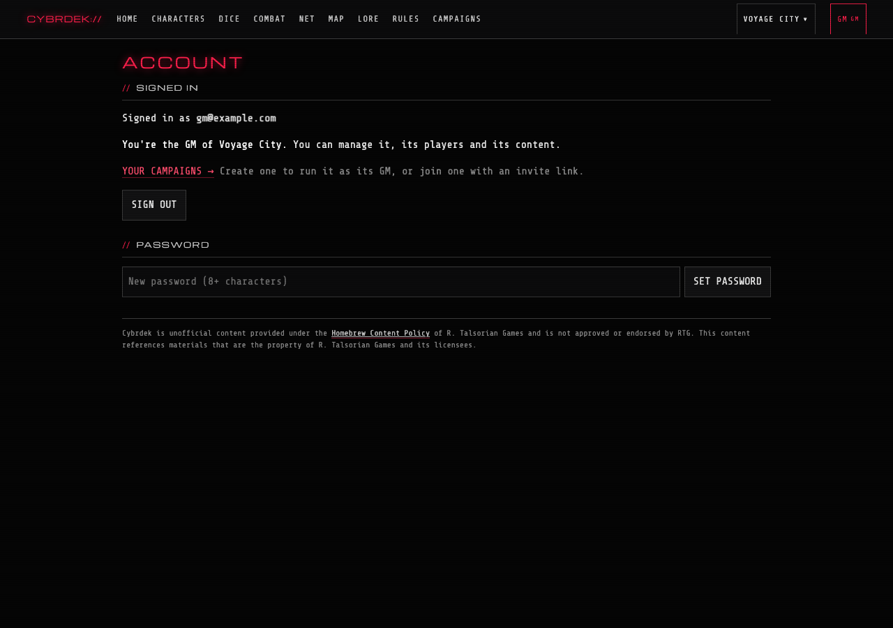](screenshots/account-1280.png) |
| [Full phone capture](screenshots/account-390.png) | [Full laptop capture](screenshots/account-1280.png) |

## Campaigns — player (supplement)

`/campaigns` · Page height: phone **900px**, laptop **900px**.

- **Visual · both:** The current character appears among generic rows with TAKE OUT controls. Make the selected character and its campaign relationship more prominent than the removal action.
- **Visual · phone:** Name-at-table, character selection and campaign switching read as equally weighted blocks. Group them under the active campaign so the player understands which settings apply where.
- **Opportunity · both:** NEW CAMPAIGN is presented immediately below player setup at similar importance. Make creating a separate campaign a secondary path once the player is already configuring this table.

| Phone · 390px | Laptop · 1280px |
| --- | --- |
| [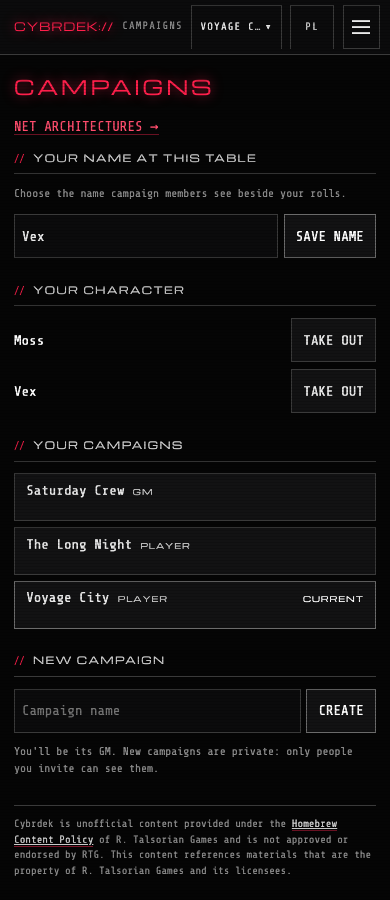](screenshots/campaigns-player-390.png) | [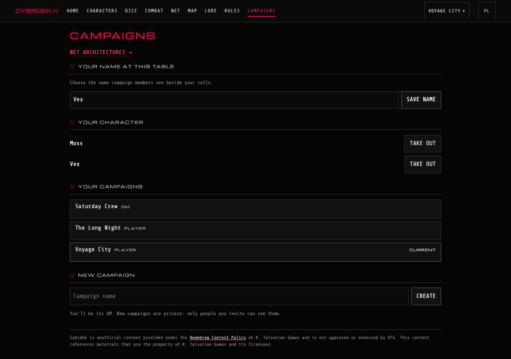](screenshots/campaigns-player-1280.png) |
| [Full phone capture](screenshots/campaigns-player-390.png) | [Full laptop capture](screenshots/campaigns-player-1280.png) |

## Account — signed out (supplement)

`/account` · Page height: phone **900px**, laptop **900px**.

- **Visual · both:** Email and password fields use placeholders as their visible labels. Persistent labels would remain visible after entry and improve scanning.
- **Visual · phone:** Create account, Forgot password and Admin email-link paths compete under the sign-in action. Group account recovery separately and deemphasize the administrative route.
- **Measured / visual · phone:** “Keep browsing without an account” is a roughly 16px-high text link below the form. Treat this valid alternative as a comfortably tappable action.

| Phone · 390px | Laptop · 1280px |
| --- | --- |
| [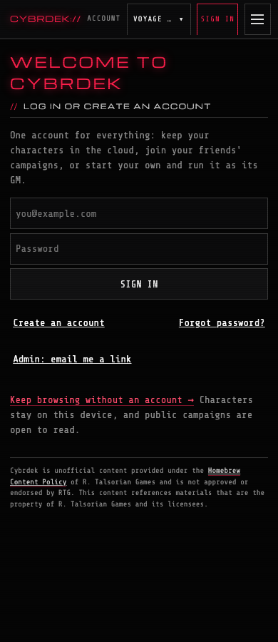](screenshots/account-sign-in-390.png) | [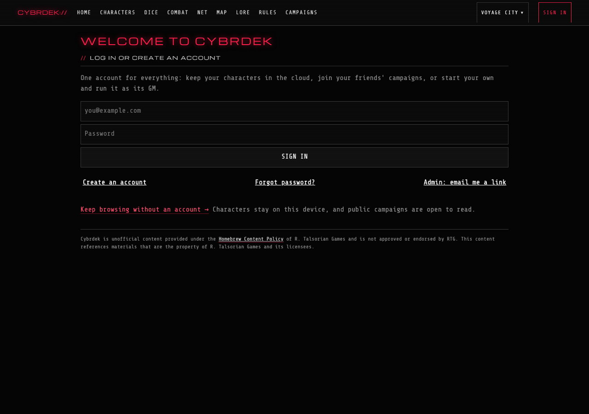](screenshots/account-sign-in-1280.png) |
| [Full phone capture](screenshots/account-sign-in-390.png) | [Full laptop capture](screenshots/account-sign-in-1280.png) |
